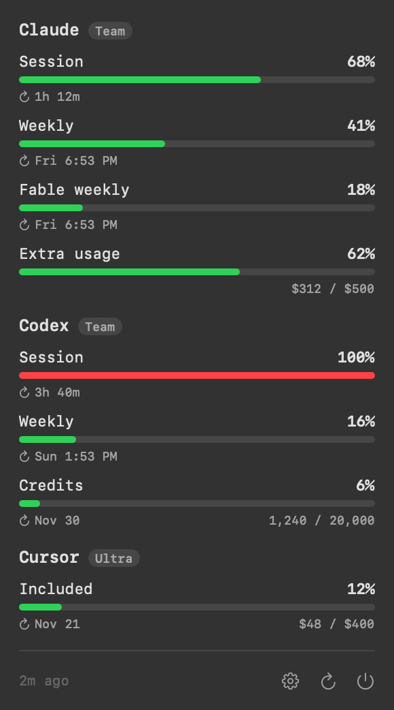
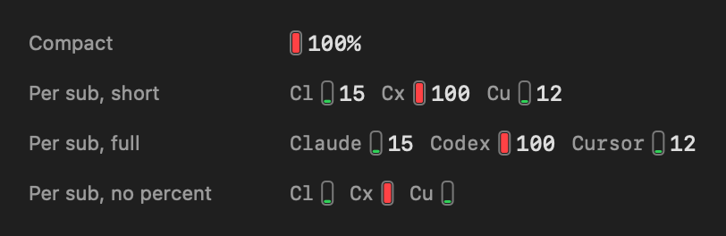

# submaxxing bar

a macos menu bar meter for your ai subscription limits. claude, codex and cursor, in one place, so you can watch yourself hit all three caps in the same afternoon.



## Install

```sh
curl -fsSL https://raw.githubusercontent.com/jakesciotto/submaxxing-bar/main/install.sh | bash
```

The script downloads the latest release, installs `Submaxxing Bar.app` in `~/Applications`, and opens it. It needs macOS 14 or later. If no release exists, it builds from source with the Xcode command line tools.

New menu bar items can start hidden. If you do not see the meter, check Bartender (or a similar app) and System Settings > Menu Bar.

## What it reads

| Subscription | Credential | Endpoint |
|---|---|---|
| Claude (Pro, Max, Team) | Claude Code's Keychain item | `api.anthropic.com/api/oauth/usage` |
| Codex (ChatGPT plans) | `~/.codex/auth.json` | `chatgpt.com/backend-api/wham/usage` |
| Cursor | Cursor app's local session | `cursor.com/api/usage-summary` |

- The app reads each token read-only and sends it only to that provider's own API.
- The app never refreshes or writes a token. When a token expires, the row tells you which app to open.
- These endpoints are undocumented. A provider can change them without notice.

## Settings



- Show or hide each subscription in the popover and in the menu bar.
- Pick a menu bar style: compact (the highest meter) or one meter per subscription.
- Hide spend rows (extra usage, credits, on-demand). Spend rows never drive the menu bar.
- Set the refresh interval, launch at login, and copy diagnostics. Diagnostics never include tokens.

## Build from source

```sh
git clone https://github.com/jakesciotto/submaxxing-bar.git
cd submaxxing-bar
./scripts/build-app.sh install
```

Run the tests with `./scripts/test.sh`. Command line tools are enough; you do not need Xcode.

## Uninstall

Quit the app from its popover, then delete `~/Applications/Submaxxing Bar.app`.

## Credits

The endpoint research leans on [CodexBar](https://github.com/steipete/CodexBar) by Peter Steinberger. Use CodexBar if you want far more providers.

## License

MIT
